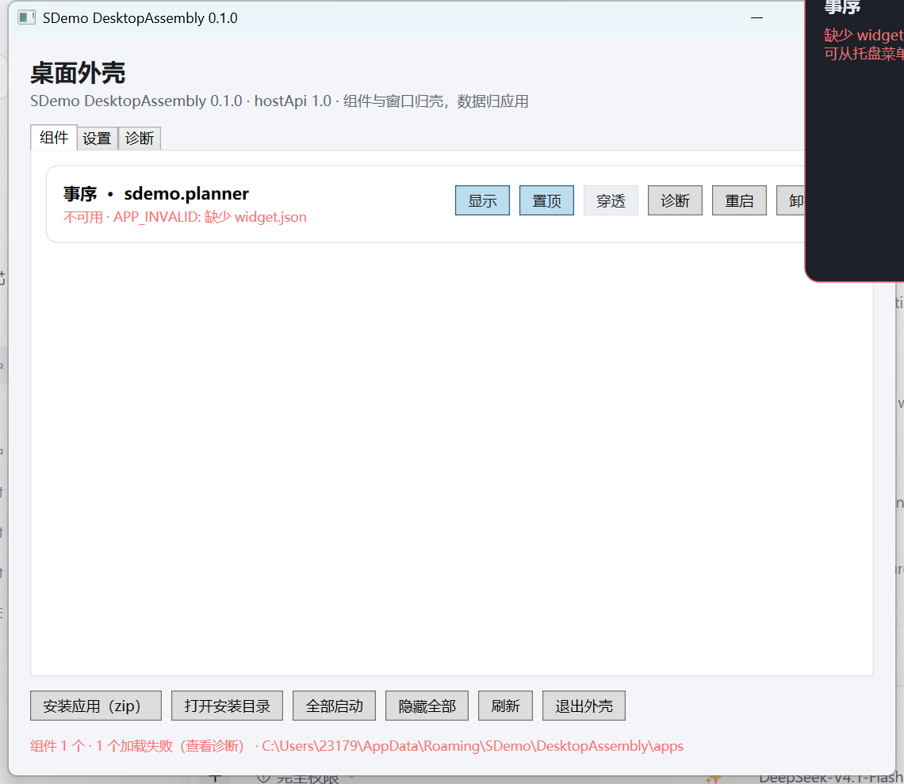

# 现状盘点：UI 架构、实现方式、应用交互与功能清单

> 采样时间：2026-11-08 · 代码基线：`DesktopAssembly` 0.1.0（hostApi 1.0）
> 采样环境：Windows 11 / 1920×1200 / 150% 缩放（dpi 144）/ 系统浅色主题
> 用途：重设计前的现状基线。只描述“现在是什么”，不包含重设计方案。
> **状态（2026-11-08）：本文描述的产品形态已被 [requirements-v2.md](requirements-v2.md) 取代，仅作 v1 现状存档。**
> 关联：[desktop-shell](desktop-shell.md) · [host-endpoints](host-endpoints.md) · [widget-contract](../../docs/contracts/widget-contract.md) · [host-protocol](../../docs/contracts/host-protocol.md) · [shell-storage](shell-storage.md)

---

## 0. 一句话概括

现在的 DesktopAssembly 是一个**“托盘常驻 + 管理面板 + 桌面小组件窗口托管器”**：

- 它没有主工作窗口。用户平时只看到托盘图标和桌面上的组件窗口；
- 管理面板（`ShellPanelWindow`）是一个 760×660 的“组件管理 / 设置 / 诊断”对话框，默认隐藏，关闭只回收托盘；
- 组件窗口由两类实现：**native**（应用自己建窗，壳跨进程摆位置）和 **wasm**（壳建 WebView2 窗口并加载页面）；
- 壳与应用之间是**回环 HTTP 协议**：壳负责拉起/停止进程、下发窗口命令；应用负责数据、业务和组件内容；
- 壳不认识任何具体应用，只认 `app.json` / `widget.json` 与 URI 字符串，不存业务数据。

---

## 1. 运行形态：进程与窗口

```
┌─────────────────────────────────────────────────────────────────────┐
│ 用户可见的界面                                                       │
│                                                                     │
│  ① 托盘图标（壳，唯一常驻）                                          │
│     双击 → 壳面板（管理 UI，默认隐藏）                                │
│     右键 → 组件/壳级操作菜单                                          │
│                                                                     │
│  ② 桌面组件窗口（每个应用最多 1 个）                                  │
│     native：应用进程自己的 HWND                                       │
│     wasm  ：壳创建的 WPF 窗口 + WebView2                              │
│                                                                     │
│  ③ 应用自己的主窗口（应用自己创建，壳不管理）                          │
│  ④ 应用自己的托盘图标（应用自己创建，壳不知道；planner 现状如此）      │
└─────────────────────────────────────────────────────────────────────┘

进程：
  SDemo.Shell.exe（单实例，常驻）
    ├─ WPF UI 线程：面板、wasm 组件窗口、骨架/占位窗
    ├─ WinForms NotifyIcon：托盘图标与菜单
    ├─ 回环 HTTP 监听：127.0.0.1:<随机端口>
    └─ 子进程：<app>.exe（按需拉起，空闲退出）
```

关键点：

- **壳是唯一常驻进程**，`SDemo.Shell.exe` 单实例（互斥量 `SDemo.Shell`）；第二次启动只激活已有面板。
- 应用**不是壳的 UI 子窗口**，而是独立进程；native 组件的窗口属于应用进程，壳只能通过 6 个白名单 Win32 调用去摆放。
- wasm 组件**不需要应用进程**：应用 `state=stopped` 时组件照样能显示（`app.json` 哈希只用于 ensure / MCP 校验）。

---

## 2. UI 架构与实现方式

### 2.1 壳面板 `ShellPanelWindow`

| 项 | 现状 |
| --- | --- |
| 技术 | .NET 10 + WPF，**纯 C# 代码构建，没有 XAML**；类 `sealed class ShellPanelWindow : Window` |
| 尺寸 | 760×660 DIP，最小 620×480；居中；`ShowInTaskbar=false` |
| 字体 | `Microsoft YaHei UI, Segoe UI` |
| 标题 | `SDemo DesktopAssembly 0.1.0`（窗口标题）；页头写“桌面外壳” |
| 视觉 | 手写 `ShellTheme` 画刷（背景/卡片/边框/强调色/危险色）；**没有样式资源字典、没有控件模板、没有图标资源**，控件基本是 WPF 默认外观 |
| 布局 | 三行：页头 → `TabControl`（组件 / 设置 / 诊断）→ 底部按钮区 + 状态行 |
| 关闭行为 | 拦截 `Closing` → `Hide()`，只回托盘；只有 `CloseForExit()` 才真关 |
| 刷新 | `Refresh()` 直接清空并重建所有行（无 MVVM、无数据绑定、无虚拟化） |
| 创建时机 | 懒加载：托盘/二次启动/退出时才创建 |

#### 组件页

每个应用一张卡片（`BuildRow`）：

- 左列：`应用名 · appId`；状态行 `状态 · renderer · widgetId · pid · 端口`，失败时改为 `状态 · 错误码: 消息`（红字）；热键错误红字。
- 右列：`显示`、`置顶`（native/wasm 都有）、`穿透`（仅 native）、`诊断`、`重启`、`卸载`。
- 空态：整块空面板 + “安装应用（zip）”“打开安装目录” + 数据保留路径说明。

> 实拍（150% 缩放）：右侧操作区在 760 DIP 固定宽度下被裁到窗口外（`WrapPanel` 放在 `Auto` 列，拿不到约束宽度，不会换行），最右的“卸载”只露出半个字。见文末截图。

#### 设置页

- 每个应用一张卡片：
  - 热键输入（应用 / 清除），`HotkeyGesture` 解析 + 冲突提示；
  - “在托盘菜单显示该组件入口”开关；
  - 权限块：已声明权限 + 授权/撤销；未知权限只展示；
  - config 表单：按 `widget.json.config`（JSON Schema 子集）渲染 boolean / 整数 / 小数 / 枚举 / 文本 / 路径；保存前严格校验，成功后 `configChanged` 下发。
- 壳设置卡：
  - 截屏隐藏（`privacy.hideFromCapture`，仅 native 生效）；
  - 壳级热键：显示/隐藏全部、切换点击穿透；
  - **没有“语言”选择、没有“开机自启”开关、没有“打开助理”入口**。

> 注：`settings.json` 里有 `startup.launchAtLogin` / `startHidden` / `logging.*`，但面板没有暴露这些开关；自启只在启动时按默认值写注册表。

#### 诊断页

- 只读文本：组件状态、最后错误、pid、端口、hwnd、config、权限、热键、清单路径、日志路径、WebView2 状态。
- 按钮：刷新 / 复制 / 打开日志目录 / 打开安装目录。

#### 实拍



> 图中：系统浅色主题、150% 缩放；唯一安装的 `sdemo.planner` 因缺少 `widget.json` 处于 `APP_INVALID`，桌面右上角是壳生成的错误占位窗（黑底红字），它浮在面板之上；面板右侧按钮被裁切。

### 2.2 托盘 `TrayService`

| 项 | 现状 |
| --- | --- |
| 技术 | WinForms `NotifyIcon` + `ContextMenuStrip`，与 WPF 混用（同一个进程） |
| 图标 | 使用系统默认/应用图标（没有专门设计的品牌图标资源） |
| 双击 | 打开面板 |
| 菜单 | 每次 `Opening` 动态重建 |
| 菜单内容 | 打开面板（粗体）；N 个组件加载失败（红字 → 诊断）；显示全部 / 隐藏全部；按 `showInTray` 的每组件子菜单（隐藏/显示、置顶、穿透（仅 native）、重启、LastError 只读）；截屏隐藏（勾选）；安装应用（zip）；打开安装目录；Win+D 实测（A/B 写日志）；组件诊断；打开 WebView2 日志目录；退出外壳 |
| 通知 | 实现 `IUserNotifier`：应用 `POST /v1/notify` → 检查权限 → 气泡（5 秒） |

### 2.3 桌面组件窗口

三类窗口都由壳创建/托管，但归属不同：

| 类型 | 谁建窗 | 壳做什么 | 限制 |
| --- | --- | --- | --- |
| native 组件 | **应用进程** | `SetWindowPos` 定位/置顶/显隐、`SetWindowLongPtr` 加 `WS_EX_TOOLWINDOW` / `WS_EX_TRANSPARENT`、`GetWindowRect` 回读、`SetWindowDisplayAffinity` 截屏隐藏、`PostMessage(WM_CLOSE)` | 不能跨进程 `SetParent`，不能贴桌面层，不能装钩子，不能接管消息循环；不抢焦点；不进任务栏/Alt+Tab |
| wasm 组件 | **壳** | 建 WPF 无边框窗 + WebView2，加载 `payload/index.html`；可 `SetParent` 到 WorkerW 做桌面层；自绘骨架遮白窗 | 不支持半透明/点击穿透；桌面层在 Win11 常回落为“普通窗口 + `HWND_BOTTOM`” |
| 骨架/占位 | **壳** | `OverlayWindow`：冷启动盖住白窗；失败显示错误卡（红字 + 重试提示） | 点击穿透、不抢焦点；目前会浮在面板等普通窗口之上 |

窗口行为：

- 显示用 `SWP_NOACTIVATE`，不抢焦点；点击后正常激活。
- 位置由壳算（DIP 存储），拖动/缩放后壳每 250ms 轮询 `GetWindowRect`，松手 500ms 防抖落盘；没有“应用上报位置”端点。
- 多屏：按 `monitorKey = 稳定显示器标识 + 分辨率 + DPI` 记忆；拔屏迁到主屏右下角，按组件顺序错开 24 DIP。
- Win+D：实测结论 A（native 组件不会被“显示桌面”收起）；壳仍保留 500ms 兜底监视，发现被收起就无激活恢复。

### 2.4 技术实现方式总结

- **表现层**：WPF（面板 / wasm 窗口 / 骨架）+ WinForms（托盘）。没有 XAML、没有 MVVM、没有资源字典、没有动画、没有导航框架。
- **组合根**：`ShellHostRuntime` 手工 new 出所有服务（无 DI 容器）。
- **状态**：`AppRegistry` 内存态 + `widgets.json` / `settings.json` 原子写；`lastError` 不落盘。
- **通信**：`HttpListener`（壳）+ `HttpClient`（应用），回环 + Bearer token。
- **窗口**：`WindowSurface` 封装 6 个 Win32 调用；`MonitorService` 枚举显示器；`DesktopLayer` 找 WorkerW。
- **打包**：`tools/pack.ps1` 产出 zip，回填 sha256。

---

## 3. 与各应用的交互逻辑

### 3.1 安装与发现

```
zip → %APPDATA%\SDemo\DesktopAssembly\apps\<appId>\
        app.json        （进程与启动信息）
        widget.json     （组件渲染与布局信息，可缺 → 该组件 APP_INVALID）
        payload\        （可执行文件 / wasm 页面）
```

- 壳扫描 `apps\`，校验：schema、`id` 唯一、`hostApiVersion` 主版本、可执行文件存在、`sha256` 匹配、wasm `payload` 存在且不越界。
- 坏清单：跳过该组件并保留布局；不阻塞壳启动；状态 `invalid`，桌面显示占位卡。
- 新组件默认 `enabled=true`、`visible=true`（装完即显示）；超过上限（默认 8）`COMPONENT_LIMIT_EXCEEDED`。
- 卸载保留 `%APPDATA%\SDemo\Apps\<appId>\` 业务数据。

### 3.2 应用生命周期状态机

```
Discovered → Validated → Launching → Handshaking → Ready ⇄ Idle → Stopped
                                              ↘ Failed（保留占位卡）
```

- **按需拉起**：`startup=onDemand|host|manual`；`host` 在壳启动时并发 ≤2 拉起；`ensure` 接口也走同一路径。
- **单实例**：命名互斥量 `SDemo.App.<appId>`；已有实例时接管（DA-22），不重复起进程。
- **空闲退出**：`app.json.idleTimeoutMs`（planner 为 300000ms）；只统计宿主↔应用调用；应用可 `request kind=idleHold` 临时保活。
- **崩溃退避**：1s / 2s / 5s，3 次失败转 `failed` 并保留占位卡，不无限重启。
- **退出顺序**：停止接受请求 → 逐应用 `POST /v1/shutdown{graceMs:2000}` → 超时 `Terminate` → 存 `widgets.json` → 删 `host.json`。

### 3.3 启动握手与窗口登记

```
壳                                                    应用
 │  启动进程，注入 SDEMO_APP_TOKEN、SDEMO_HOST_URL      │
 │ ───────────────────────────────────────────────────►│
 │                                                     │ 绑定 127.0.0.1:0，写 runtime.json
 │  GET  /v1/health                                    │
 │ ◄───────────────────────────────────────────────────│
 │  POST /v1/handshake { capabilities }                │
 │ ◄───────────────────────────────────────────────────│  交换版本/能力，双向降级
 │                                                     │
 │  POST /v1/apps/{appId}/register { widgetId, hwnd }  │  ← 应用 → 壳
 │ ◄───────────────────────────────────────────────────│
 │  SetWindowPos / SetWindowLongPtr / ShowWindow ...   │  ← 壳摆放窗口
```

- token：`SDEMO_APP_TOKEN` 注入；应用读回 `runtime.json` 必须与注入一致，否则 `HOST_TOKEN_INVALID`（不重试）。
- 应用注册的 `hwnd` 无效 → 壳告警并丢弃；窗口丢失 → `WIDGET_WINDOW_LOST` 占位。

**一次“显示组件”的完整时序（native）**

1. 壳读 `widgets.json`，该组件 `visible=true`；`ShowWidget` 发现还没有 `hwnd`。
2. 壳按布局算位置，先显示**骨架窗**（`OverlayWindow`，盖住即将出现的白窗）。
3. `EnsureAsync`：单飞、校验哈希/互斥量、启动 `<app>.exe`，注入 `SDEMO_APP_TOKEN` 与 `SDEMO_HOST_URL`。
4. 应用绑定 `127.0.0.1:0`、写 `runtime.json`；壳 `GET /v1/health`、`POST /v1/handshake`。
5. 应用创建组件窗口，`POST register { widgetId, hwnd, dpiAware }`。
6. 壳 `SetToolWindow` → `SetWindowPos`（不激活）→ 穿透 → `ShowWindow`，关掉骨架。
7. 壳下发 `configChanged { opacity, theme, config }`；此后每 250ms 轮询位置，松手 500ms 落盘。
8. 用户点“隐藏”：壳 `SetVisible(false)` + 下发 `hide`；应用也可自行隐藏窗口。
9. 空闲 5 分钟：壳 `POST /v1/shutdown`，应用退出；组件窗口随之消失（下次显示重新走 1–7）。

### 3.4 宿主 → 应用

| 端点 | 用途 |
| --- | --- |
| `GET /v1/health` | 健康检查 |
| `POST /v1/handshake` | 版本/能力交换 |
| `POST /v1/shutdown` | 优雅退出（2 秒） |
| `POST /v1/widgets/{id}/command` | `show` / `hide` / `focus` / `refresh` / `themeChanged` / `configChanged`（带 `opacity` / `theme` / `config`） |
| `GET /v1/widgets/{id}/state` | 组件状态 |

### 3.5 应用 → 宿主

| 端点 | 用途 |
| --- | --- |
| `POST /v1/apps/{appId}/register` | 上报 native 窗口 `hwnd`、DPI 感知 |
| `POST /v1/apps/{appId}/unregister` | 注销窗口 |
| `POST /v1/apps/{appId}/notify` | 通知（标题/正文/级别）→ 托盘气泡 |
| `POST /v1/apps/{appId}/request` | 策略请求：`layer` / `alwaysOnTop` / `clickThrough` / `idleHold` |
| `GET /v1/host/info` | 宿主版本、主题、强调色、API 版本 |

### 3.6 面向 Agent 的 client 面（只读发现 + ensure）

| 端点 | 用途 |
| --- | --- |
| `GET /v1/host` | 宿主信息 |
| `GET /v1/apps` | 已安装应用注册表（只读） |
| `GET /v1/apps/{appId}` | 单应用信息 |
| `POST /v1/apps/{appId}/ensure` | 冷启动拉起应用（**不显示组件**） |

- 两类 token：app token 与 client token 不复用；只允许回环、拒绝 `Origin`、校验 `Host` 头防 DNS rebinding。
- 壳**不代理 MCP**、不列工具清单、不做应用间通信；Agent 直接连应用自己的 MCP server。

### 3.7 窗口管控的实现细节

- Win32 白名单只有 6 个：`SetWindowPos`、`GetWindowRect`、`SetWindowLongPtr(GWL_EXSTYLE)`（仅 `WS_EX_TOOLWINDOW` / `WS_EX_TRANSPARENT`）、`ShowWindow`、`PostMessage(WM_CLOSE)`、`SetWindowDisplayAffinity`。
- 禁止：跨进程 `SetParent`、改 `GWLP_HWNDPARENT` / `WS_CHILD`、全局钩子、跨进程 `SendMessage`、接管消息循环。
- wasm 窗口是壳自己的，才允许 `SetParent` / `MapWindowPoints` / 找 WorkerW。
- 位置回写：轮询而非事件；桌面层与 wasm 的 z-order 不参与回写。

### 3.8 配置、主题、权限、通知、热键

| 能力 | 行为 |
| --- | --- |
| config | `widget.json.config` 是 JSON Schema 子集（boolean/integer/number/string，enum/path 为 string 变体）；壳渲染表单，值存 `widgets.json.config`，下发 `configChanged` |
| 主题 | 壳监听系统深/浅色 + 强调色；面板/骨架/占位即时换色；native 应用收 `themeChanged`；wasm 页面靠 `prefers-color-scheme`（**没有运行时桥**） |
| 权限 | `http-localhost` 恒授权；`notifications` 首次 `MessageBox` 询问一次；未知权限只展示；决策存 `widgets.json.permissions` |
| 通知 | 应用 `notify` → 壳检查权限 → 托盘气泡 5 秒；无队列 |
| 热键 | 全局 `RegisterHotKey`；组件热键来自清单或 `hotkeyOverride`；壳级热键在 `settings.json`；冲突不静默，面板/托盘显示错误 |
| 开机自启 | 壳自己写 HKCU Run `SDemo.Shell`，默认开；应用不单独注册 |
| 截屏隐藏 | `SetWindowDisplayAffinity(WDA_EXCLUDEFROMCAPTURE)`，回退 `WDA_MONITOR`；仅 native |

### 3.9 壳存储（零业务数据）

```
%APPDATA%\SDemo\DesktopAssembly\
  settings.json    壳级：自启、组件上限、热键、隐私、语言、日志
  widgets.json     每组件：显隐、层级、置顶、穿透、透明度、锚点、位置、config、权限、热键覆盖、托盘入口
  apps\<appId>\    安装目录
  widgets.json.bak 上一次成功写入

%LOCALAPPDATA%\SDemo\DesktopAssembly\
  runtime\host.json       端口 / pid / 版本 / revision
  runtime\client-token    客户端 token
  webview2\               共享 WebView2 user data
%LOCALAPPDATA%\SDemo\logs\ 按天 10MB 轮转
```

- 写入：先序列化校验 → `.tmp` → `File.Replace`（带 `.bak`）；500ms 防抖；单写者（只有壳写）。
- 损坏：改名 `widgets.corrupt-<ts>.json` 后按默认启动；`.bak` 可用则优先；高版本只读不回写。
- 未知字段保留（向前兼容）。

### 3.10 应用自己的主窗口 / 托盘 / MCP（壳之外）

- 应用可以有自己的主窗口、自己的托盘图标（planner 现状：关闭主窗只收进托盘，进程继续跑提醒）。
- 应用启动参数里**没有** `--headless`；壳 `ensure` 拉起 planner 时会走 `RunDesktop`，即会创建主窗口。
- 应用自带 MCP server（回环 + runtime token），设计上由 DesktopAgent 作为 MCP client 直连；壳只提供发现与 `ensure`。
- 壳**没有**“打开应用主窗口”“打开助理”“深链跳转”的入口或命令。

---

## 4. 已有功能清单

图例：✅ 已实现并验收 · ⚠️ 已实现但有明确限制 · ❌ 未实现

### 4.1 壳与组件

| 功能 | 状态 | 说明 |
| --- | --- | --- |
| 托盘常驻、单实例、二次启动激活面板 | ✅ | |
| 组件扫描、清单校验、sha256、版本降级 | ✅ | 坏清单跳过并保留布局 |
| 按需拉起 / 单实例接管 / 空闲退出 / 崩溃退避 | ✅ | 1/2/5s，3 次转 failed |
| 组件显示 / 隐藏 / 全部显示 / 全部隐藏 | ✅ | 面板、托盘、热键 |
| 置顶切换 | ✅ | |
| 点击穿透切换 | ⚠️ | 仅 native；wasm 拒绝 |
| 组件拖动、位置回写、吸附、按显示器记忆 | ✅ | 轮询 + 防抖；无应用上报 |
| 多屏热插拔迁移 | ✅ | 主屏右下角错开 24 DIP |
| 冷启动骨架 / 失败占位卡 | ✅ | |
| Win+D 保持可见 | ✅ | 实测 A；兜底监视 |
| 组件上限 8（可配 1–8） | ✅ | |
| 一应用一组件 | ⚠️ | v1 契约限制；数组判非法 |
| native 半透明 / 点击穿透 | ⚠️ | 由应用自绘，壳只传值 |
| 截屏 / 录屏隐藏 | ⚠️ | 仅 native |
| wasm 渲染器（WebView2） | ✅ | 共享 Environment；骨架遮白窗 |
| wasm 桌面层 | ⚠️ | Win10 WorkerW；Win11 回落 z-order 底部 |
| wasm 运行时桥（主题/配置进页面） | ❌ | 只靠 `prefers-color-scheme` |
| wasm 拖动 | ❌ | |
| 组件自更新 / 壳自更新 | ❌ | 明确非目标 |

### 4.2 管理 UI

| 功能 | 状态 |
| --- | --- |
| 组件卡片：状态、pid、端口、错误、热键错误 | ✅ |
| 显示 / 置顶 / 穿透 / 诊断 / 重启 / 卸载 | ✅ |
| 安装 zip（校验 + 回填 sha256 + 替换目录） | ✅ |
| 空态安装入口 | ✅ |
| 设置页：热键、托盘入口、权限、config 表单 | ✅ |
| 壳设置：截屏隐藏、壳级热键 | ✅ |
| 诊断页：完整信息 + 复制 + 打开日志 | ✅ |
| 主题跟随系统 | ✅ |
| 语言切换 | ❌ | 仅 `zh-CN` |
| 开机自启开关（UI） | ❌ | 只有默认写注册表 |
| 打开应用主窗口 | ❌ | 壳无此命令 |
| 打开助理 | ❌ | 需求 Q7 提到，但代码中无入口 |
| 组件分组 / 排序 / 多实例 / 工作区 | ❌ | 无 |

### 4.3 协议与集成

| 功能 | 状态 |
| --- | --- |
| 回环 HTTP + 双 token + Host/Origin 校验 | ✅ |
| 握手、健康检查、优雅退出 | ✅ |
| 窗口登记 / 注销 / 通知 / 策略请求 / host-info | ✅ |
| client 面：host / apps / app / ensure | ✅ |
| MCP 代理 / 工具清单 | ❌ | 明确非目标 |
| 应用间通信 / 统一搜索 | ❌ | 明确非目标 |
| 深链 / URI 转发 | ❌ | 明确非目标 |
| Agent 侧 MCP client | ❌ | P3，且不在本仓 |
| 发现注册表 schema（给 Agent） | ⚠️ | 只有 HTTP 只读接口 |

### 4.4 非功能

| 项 | 状态 |
| --- | --- |
| 常驻内存 ≤120MB（不含 WebView2） | ✅ P1 实测约 57MB Private |
| 日志按天轮转、10MB | ✅ |
| 原子写 + 备份 + 损坏恢复 | ✅ |
| 打包 zip + sha256 | ✅ |
| 安装/数据分离 | ✅ |
| 自动更新 | ❌ |
| 多用户 / 云同步 | ❌ |

---

## 5. 结构性问题（事实观察，供重设计讨论）

1. **壳没有“工作入口”，只有“管理入口”**。面板是设置/诊断对话框；用户日常看到的只有托盘和桌面小组件；打开应用主窗口、打开助理都没有壳级入口。
2. **托盘重复**。壳有托盘，应用（planner）也有自己的托盘和主窗口；壳不知道应用主窗口的存在，也无法统一管理。
3. **应用拉起会弹主窗口**。`app.json.arguments` 为空，`ensure` 走应用的桌面模式（`RunDesktop`），并非“无窗内核”。
4. **交互是单向的**。壳下发 `show/hide/theme/config`，应用上报 `hwnd/notify/request`；没有“用户点击组件 → 打开应用某页面”的通用语义（只能应用自己在组件内处理）。
5. **wasm 是“静态页面”**。没有主题/配置/状态的运行时桥，也不能拖动；相比 native 是明显的二等公民。
6. **布局不自适应**。面板初始 760×660、可缩放，但卡片操作区是 `Auto` 列里的 `WrapPanel`，拿不到约束宽度、不会换行；150% 缩放下初始尺寸就会裁掉右侧按钮（实拍已见）。
7. **视觉是默认控件**。无 XAML、无样式资源、无图标、无动画；与“桌面工作台”的产品预期差距主要在这里，而不在功能数量。
8. **一个应用只能有一个组件**。契约 v1 限制，组件数量上限 8；没有分组、图层、工作区、场景的概念。
9. **当前安装态是坏的**。唯一安装的 `sdemo.planner` 缺少 `widget.json`，面板显示 `APP_INVALID`，桌面显示错误占位卡；即“打开就能用”的演示态不成立。
10. **“打开助理”缺失**。需求 Q7 说壳只提供入口，但代码与 UI 都没有这个入口。

---

## 6. 重设计前需要确认的问题

1. 你要的“桌面”是**工作台/启动器**（应用入口、最近使用、搜索、助理），还是**组件容器**（只摆小组件）？
2. 应用主窗口应由壳统一打开/切换，还是继续由应用自己管托盘与主窗？
3. 组件是“每个应用一个”，还是允许一个应用多个组件/多实例/分组？
4. 组件交互是否需要通用能力（点击打开指定页面、右键菜单、拖拽排序、悬停展开）？
5. wasm 是否要升级为一等公民（运行时桥、拖动、主题、配置、甚至离线状态）？
6. 视觉方向：继续 WPF 默认控件，还是引入完整设计系统（XAML 资源、图标、动效、深浅色）？
7. 是否需要面向 Agent 的“统一入口”（发现、ensure、深链、打开助理），还是保持现在的只读发现？
8. 现有 6 个 Win32 白名单 / 零业务数据 / 一应用一写者这些铁律，哪些可以动，哪些不能动？

---

## 附：关键代码位置

| 主题 | 文件 |
| --- | --- |
| 面板 | `src/SDemo.Shell.Wpf/Panel/ShellPanelWindow.cs` |
| 托盘 | `src/SDemo.Shell.Wpf/Tray/TrayService.cs` |
| 组件编排 | `src/SDemo.Shell.Wpf/Widgets/WidgetController.cs` |
| wasm 宿主 | `src/SDemo.Shell.Wpf/Widgets/WasmWidgetHost.cs` |
| 骨架/占位 | `src/SDemo.Shell.Wpf/Widgets/OverlayWindow.cs` |
| 窗口/显示器 | `src/SDemo.Shell.Wpf/Win32/{WindowSurface,MonitorService,DesktopLayer,NativeMethods}.cs` |
| 组合根 | `src/SDemo.Shell.Host/ShellHostRuntime.cs`、`Program.cs` |
| 进程管家 | `src/SDemo.Shell/Processes/AppProcessManager.cs` |
| 回环端点 | `src/SDemo.Shell/Hosting/ShellHostServer.cs` |
| 注册表/安装 | `src/SDemo.Shell/Registry/AppRegistry.cs`、`Install/AppInstaller.cs` |
| 状态存储 | `src/SDemo.Shell/Storage/ShellStateStore.cs`、`Storage/AtomicFile.cs` |
| 契约 | `src/SDemo.Shell.Contracts/*.cs` |
