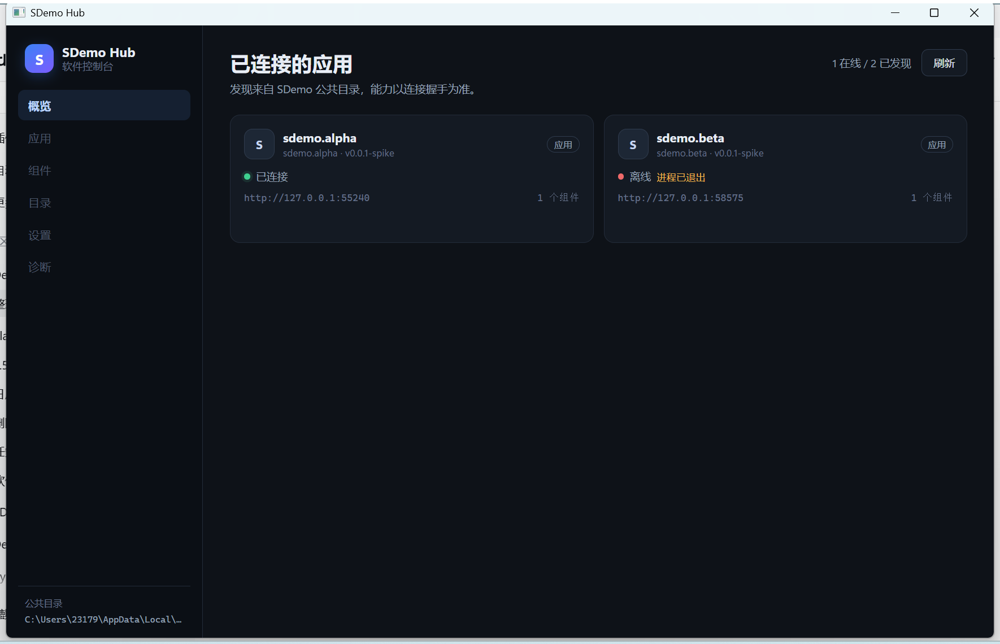

# M1 骨架：Hub 发现 + 握手 + 应用列表

> 状态：**骨架完成**（2026-11-08）。代码在 `src/SDemo.Hub.*`，本文记录已落地范围、验证方式与缺口。
> 契约：已冻结，见主仓 [hub-protocol.md](../../docs/contracts/hub-protocol.md) 与 [hub-app.schema.json](../../docs/contracts/hub-app.schema.json)。
> 目标是先把「公共目录 → 发现 → 握手 → 控制台列表」这条主链路跑通，组件宿主从 M2 开始。



## 1. 已落地

### 1.1 工程

| 工程 | 作用 |
| --- | --- |
| `src/SDemo.Hub.Contracts` | 连接配置 / `/v1/info` / 组件描述 DTO，JSON 约定 |
| `src/SDemo.Hub` | 目录发现、注册表、连接探测 |
| `src/SDemo.Hub.App` | WPF + Blazor Hybrid 控制台（`Microsoft.AspNetCore.Components.WebView.Wpf 10.0.110`） |
| `tests/SDemo.Hub.Tests` | 发现/注册表/探测 11 个用例 |

解决方案过滤器 `SDemo.Hub.slnf`，门禁命令：

```powershell
dotnet build SDemo.Hub.slnf -c Release
dotnet test tests/SDemo.Hub.Tests -c Release
```

### 1.2 发现

`HubAppDiscovery`（`src/SDemo.Hub/HubAppDiscovery.cs`）：

- 监听 `%LOCALAPPDATA%\SDemo\Hub\apps\*.json`（`SDEMO_HUB_ROOT` 可覆盖根目录，测试用）。
- `FileSystemWatcher` 250ms 去抖后**全量重扫**，避免读到半写入文件。
- 同一 `appId` 的新配置覆盖旧值；文件消失的条目从注册表移除。
- 坏 JSON / 缺 `appId` / 端口越界 → 保留一张「配置无效」卡片，不阻塞其他应用。
- 不判断进程是否存活；存活与能力交给探测。

### 1.3 握手

`HubConnectionMonitor`（`src/SDemo.Hub/HubConnectionMonitor.cs`）：

- 每 5s 对 `state=running` 的条目调用 `GET {baseUrl}/v1/info`，带 `Authorization: Bearer <token>`。
- 200 → `Online`，用 `/v1/info` 覆盖 `kind`、`version`、`widgets`、`mcp`、`agent`、`mainWindow`。
- 401/403 → `Unauthorized`；其他非 2xx / 超时 / 连接失败 → `Offline`，保留上次成功信息。
- `pid > 0` 且进程不存在 → `Offline`（进程已退出），不发请求。
- `state=stopped` → `Stopped`，不发请求。
- 校验响应 `appId` 与配置一致，防止端口串台。

### 1.4 控制台

`SDemo.Hub.App`：

- 1180×760，左侧 232px 导航；概览页显示已发现应用卡片。
- 卡片：名称、appId、版本、kind 徽标、在线状态、端点、组件数、MCP/Agent 标签、错误摘要。
- 点击卡片展开详情（端点、MCP、Agent、组件数、进程状态）。
- 空态引导 + 公共目录路径常驻侧栏底部。
- 顶部「N 在线 / M 已发现」+ 手动刷新（触发一次全量探测）。

## 2. 验证

### 2.1 自动化

```text
dotnet build SDemo.Hub.slnf -c Release   → 0 warning / 0 error
dotnet test tests/SDemo.Hub.Tests         → 11 passed
```

覆盖：有效配置发现、同 appId 覆盖、文件删除移除、坏 JSON 可见、端口校验、注册表排序、握手成功、401、appId 不匹配、stopped 状态。

### 2.2 端到端

```powershell
# 1. 起一个示例应用（会写连接配置）
dotnet publish spike/Spike.WidgetHost -c Release -o spike/out/host
spike/out/host/Spike.WidgetHost.exe --app-id sdemo.alpha --token <64位> --run-seconds 180

# 2. 起 Hub
dotnet publish src/SDemo.Hub.App -c Release -o out/hub
out/hub/SDemo.HubApp.exe
```

实测结果（2026-11-08）：

- `sdemo.alpha` 出现在列表，状态「已连接」，端点 `http://127.0.0.1:53255`，组件数 1。
- 另一个残留配置 `sdemo.beta` 显示「离线 · 进程已退出」，说明离线卡片与错误摘要生效。
- Hub 每 5s 请求 `/v1/info`，示例宿主日志返回 200。

> 注意：示例宿主同时提供 `/health`（无鉴权）与 `/v1/info`（Bearer）。真实应用必须把 `/v1/info` 当作 API，而不是组件页面；组件页面仍走 `<appId>.localhost` + cookie。

## 3. 已知缺口（进 M2 前补）

1. **启动应用未实现**：当前只发现+握手，没有「离线卡片 → 用 executable 启动 → 等待端口 → 在线」。
2. **连接状态机不完整**：没有 `Connecting` 的显式阶段、退避、断线重连计数；探测是固定 5s 轮询。
3. **Hub 自身未注册**：还没有写 `sdemo.hub.json`，目录 MCP 也没有（M3）。
4. **组件宿主未接**：详情里的组件数只是展示，不能添加到桌面。
5. **无托盘/单实例/退出清理**：关闭主窗即退出；没有托盘常驻。
6. **无设置/诊断页**：导航项禁用占位。
7. **无主题切换**：当前只有深色。
8. **Blazor 静态资产**：开发时用 `dotnet run` 或 publish；直接跑 `bin` 可能找不到 `wwwroot`。
9. **启动配置校验较松**：只校验 appId/port/state/baseUrl；schema 的完整校验待补。
10. **示例宿主的 `mainWindow`/`widgets` 字段已对齐契约，但真实应用模板还没抽**。

## 4. 下一步（M2）

1. 把 `WidgetController` 的窗口行为（置顶/穿透/位置/多屏/Win+D）迁到 v2，宿主从 native 改为 WebView2。
2. 组件窗口：`WebView2` 导航到 `http://<appId>.localhost:<port><entry>`，cookie 注入 + 骨架 + 401 占位。
3. 应用退出/重启：组件转离线占位、自动恢复。
4. 启动应用：离线卡片操作 + 等待 `/v1/info` 上线。
