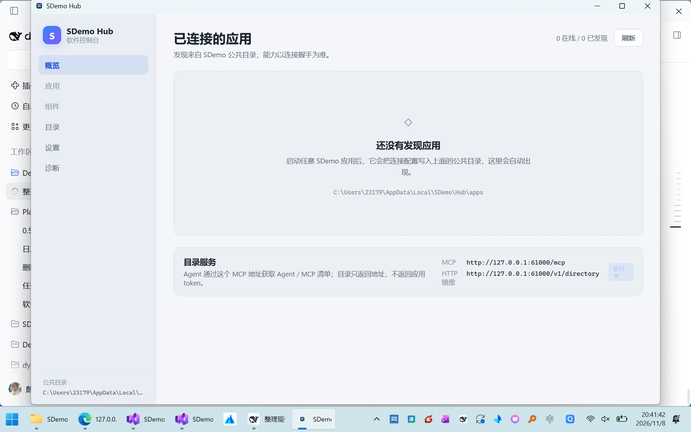
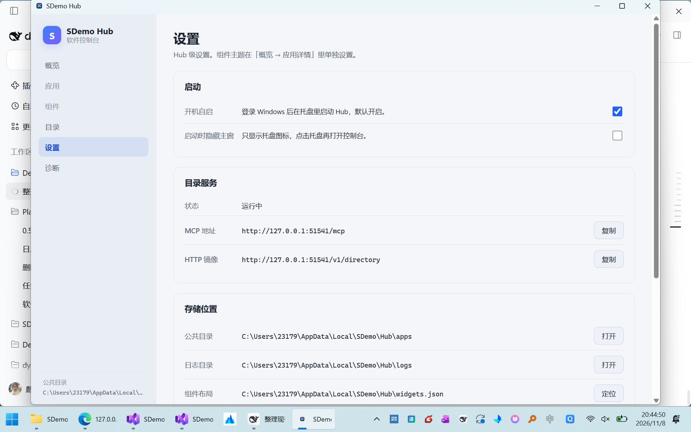

# M4 · 图标、热键、托盘、单实例与打包

> 状态：已落地（2026-11-08）。对应需求 [requirements-v2.md](requirements-v2.md) M4 行。
> 前序：[m3-directory-tray.md](m3-directory-tray.md)。
> 图标资产：[sdemo-hub-icon-2026-11-08.png](assets/sdemo-hub-icon-2026-11-08.png)。

---

## 1. 本阶段做了什么

| 能力 | 落点 |
| --- | --- |
| 应用图标 | `Assets/sdemo-hub.ico`，exe / 主窗 / 托盘统一 |
| 每组件全局热键 | `HotkeyService` + `widgets.json.hotkey` |
| 托盘菜单 | 打开 Hub、显示/隐藏全部、逐组件、穿透、设置、诊断、退出 |
| 单实例 | `Local\SDemo.Hub` + `Local\SDemo.Hub.Activate` |
| 隐藏启动 | `--hidden` / 设置「启动时隐藏主窗」 |
| 开机自启 | HKCU Run，默认开启，可关闭 |
| 多屏几何 | 主屏工作区 + 副屏虚拟桌面钳制 |
| 点击穿透 | `WS_EX_TRANSPARENT` + `WS_EX_NOACTIVATE`，Hub/托盘可恢复 |
| 打包 | `tools/pack-hub.ps1` → `dist/SDemo-Hub-<ver>.zip` |

## 2. 图标

设计是四块渐变瓦片围住中心 hub 圆环，分别对应 SDemo 的不同应用类型：

| 元素 | 色值 |
| --- | --- |
| 背景 squircle | `#0B1220 → #141C2E` |
| 蓝瓦片 | `#8EACFF → #4A66F5` |
| 紫瓦片 | `#CA9CFF → #7C3AED` |
| 青瓦片 | `#56E7FF → #0891B2` |
| 绿瓦片 | `#60EBB4 → #059669` |
| 中心 hub | 白色圆环 + 深蓝内点 + 浅蓝高光 |

生成脚本 `spike/make-icon.py` 用 Pillow 4096 超采样，输出：

- `src/SDemo.Hub.App/Assets/sdemo-hub.png`（1024）
- `src/SDemo.Hub.App/Assets/sdemo-hub.ico`（16/20/24/32/40/48/64/128/256）

应用方式：

- `SDemo.Hub.App.csproj`：`ApplicationIcon` + `Resource`；`Version/FileVersion` 同步 `0.2.0`。
- 主窗：`Icon = pack://application:,,,/Assets/sdemo-hub.png`（用 1024 PNG，避免 WPF 取 ICO 首帧导致任务栏只显示 16px）。
- 托盘：`Icon.ExtractAssociatedIcon(Environment.ProcessPath)`，失败回退系统图标。



## 3. 热键

### 3.1 语法

`HotkeyGesture.TryParse` 支持：

- 修饰键：`Ctrl` / `Alt` / `Shift` / `Win`，可组合。
- 主键：`A-Z`、`0-9`、`F1-F24`、`Space`、`Enter`、`Tab`、`Esc`、方向键、`Home/End/PageUp/PageDown/Insert/Delete` 等。
- 非功能键必须至少带一个修饰键，避免抢占裸键。
- 规范化顺序固定为 `Ctrl+Alt+Shift+Win+Key`。

### 3.2 注册与冲突

- 每个组件一个 owner（`{appId}/{widgetId}`），注册在 Hub 主窗的 `HwndSource` 上，处理 `WM_HOTKEY`。
- 同一 owner 重新设置时先注销旧热键；注册失败（被其它程序占用）返回错误，UI 显示原因，不覆盖磁盘上的旧值。
- 热键随 `widgets.json.hotkey` 持久化；Hub 启动时恢复并重新注册。
- 清空输入框 = 注销并写 `null`。

### 3.3 显示/隐藏语义

热键只切换窗口可见性，不从桌面移除：

- 可见 → `Hide()`；不可见 → `Show()` + `Activate()` + 短暂 `Topmost` 闪切。
- 隐藏后组件仍保留在 `widgets.json`，托盘菜单仍可恢复。

## 4. 托盘

关闭主窗只隐藏，进程继续常驻；退出必须走托盘菜单。菜单每次打开时重建：

```
打开 SDemo Hub
────────────
显示全部组件
隐藏全部组件
组件 ▸ 日历                （勾选当前可见）
       点击穿透            （勾选当前状态）
────────────
设置
诊断
打开公共目录
────────────
退出外壳
```

托盘图标直接取 exe 图标，不额外维护第二套资源。

## 5. 单实例、隐藏启动与自启

### 5.1 单实例

- 互斥量 `Local\SDemo.Hub`；第二个实例不创建窗口，只 `Set` 命名事件 `Local\SDemo.Hub.Activate` 后退出。
- 首实例后台线程等待事件，收到后 `ShowWindow()`：恢复、激活、Topmost 闪切。

### 5.2 隐藏启动

- 命令行 `--hidden`：不显示主窗，托盘与热键照常工作。
- 设置项 `startHidden`：效果同上，供自启使用。
- 关闭主窗永远只隐藏，不退出。

### 5.3 开机自启

- `AutostartService.Apply` 写 HKCU `Software\Microsoft\Windows\CurrentVersion\Run`：
  `"<exe>" --hidden`。
- 默认 `launchAtLogin=true`；关闭时删除该值。
- 设置页改动即时生效，不需要重启。



## 6. 多屏与窗口几何

- 新组件默认落在主屏 `(120, 100)`，按已有组件数偏移 28 DIP。
- 主屏使用 `SystemParameters.WorkArea`（不含任务栏）；副屏使用虚拟桌面范围，避免被拉回主屏。
- 宽高按目标工作区钳制，最小 480×360；窗口创建和恢复都走同一套钳制。
- 拖动/缩放后 600ms 防抖写回 `widgets.json`，存 DIP。

> 多屏拔插的“按显示器记忆”仍是 M5 候选；当前保证不跑到屏幕外、不被任务栏裁切。

## 7. 点击穿透

- `HubWidgetPlacement.ClickThrough` 持久化。
- 开启时给组件窗口加 `WS_EX_TRANSPARENT | WS_EX_NOACTIVATE`，鼠标事件落到下层窗口。
- 穿透后窗口自身按钮不可点，必须从 Hub 详情「关闭穿透」或托盘「组件 → 点击穿透」恢复。
- 恢复时移除这两个扩展样式，窗口重新可交互。

## 8. 打包

```powershell
pwsh tools/pack-hub.ps1
```

脚本会：

1. `dotnet publish src/SDemo.Hub.App -c Release -o out/hub-publish`
2. 从 exe `ProductVersion` 取版本（当前 `0.2.0`）
3. 生成 `dist/SDemo-Hub-0.2.0/` 与 `dist/SDemo-Hub-0.2.0.zip`
4. 输出 SHA256

当前产物：

```text
dist/SDemo-Hub-0.2.0.zip
SHA256 FA563A8B5F9BEB5B305102A520C20498A4FB28C8C2A68F457C3560A1CF1FD3D6
```

## 9. 验证记录

| 项 | 结果 |
| --- | --- |
| `dotnet build SDemo.Hub.slnf -c Release` | 0 warning / 0 error |
| `dotnet test tests/SDemo.Hub.Tests -c Release` | 60 passed |
| exe 图标 | `ExtractAssociatedIcon` 得到四色 hub 图标；ProductVersion `0.2.0+…`，FileVersion `0.2.0.0` |
| 隐藏启动 | `--hidden` 后主窗不可见、进程存活 |
| 单实例 | 第二个实例退出，首实例主窗被唤醒 |
| 自启 | 开启写 Run 值，关闭删除；设置页与注册表一致 |
| 热键初始可见性 | 修复后组件启动即 `IsWindowVisible=True`；按 `Ctrl+Alt+K` → False，再按 → True |
| 点击穿透 | exstyle `0x80001A0`；`WindowFromPoint` 命中下层窗口；Hub 关闭后恢复 |
| Win+D | 组件 `before=True / after=True / restored=True` |
| 离线 | 停 Planner 后组件显示「应用当前离线。等待重连…」；重启后自动恢复日历 |
| 打包 | zip + SHA256 生成成功 |

## 10. 已知缺口

- 托盘菜单尚未做自动化 UI 测试，只做了手工代码路径核对与截图。
- 多显示器物理拔插未实测；当前只保证几何钳制。
- 同一应用两个组件的热键冲突场景没有真实第二组件可测；服务端按 owner 隔离，逻辑上支持。
- 点击穿透后没有“穿透中”的桌面角标，用户只能从 Hub/托盘判断。
- 包未签名，SmartScreen 可能提示。
- 自动更新、开机自启的组策略限制未处理。

