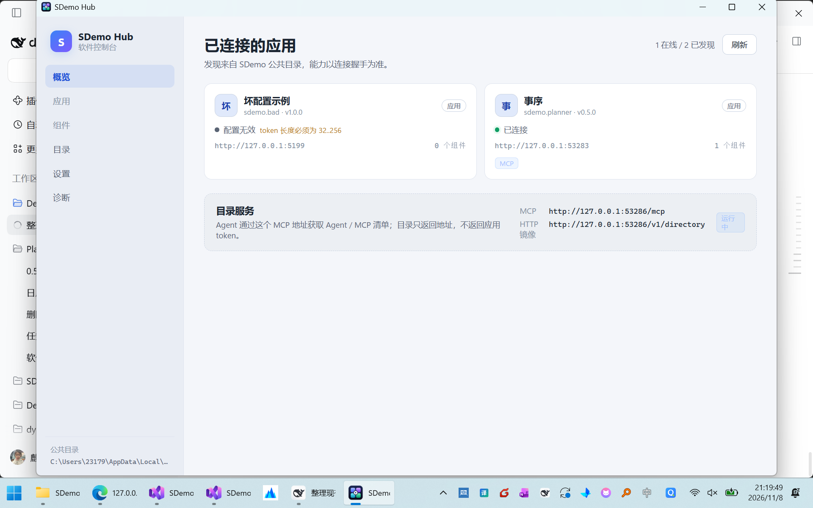
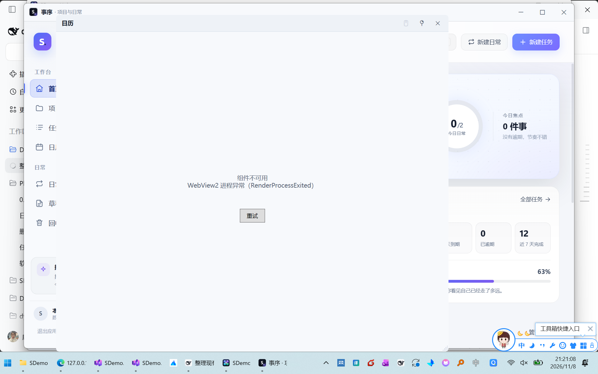

# P0 加固：配置校验、启动状态机、WebView2 恢复（2026-11-08）

> 范围：[requirements-v2.md](requirements-v2.md) 的 FR-1.3 / FR-1.9 / FR-2.5 / FR-2.6 / FR-3.4 / FR-5.12。
> 结论：六项均已落地，`60` 个测试通过；非法配置、离线启动、renderer 崩溃三条路径已手工验证。

---

## 1. 配置校验与上限（FR-1.3 / FR-1.9）

新增 `src/SDemo.Hub/HubConfigValidator.cs`，发现阶段统一调用：

| 校验 | 规则 |
| --- | --- |
| 基础字段 | `schemaVersion == 1`；`appId` 合法且与文件名一致；`displayName` 1..64；`version` 1..32；`kind` 为 `app` / `agent` / `hub` |
| 地址 | `baseUrl` 只能是 `http://127.0.0.1:<port>`，且端口与 `port` 一致；`mcp` / `agent` 只能是相对 path 或绝对回环 HTTP(S) URL |
| 运行态 | `state=running` 时 `port/baseUrl/token/pid/startedAt` 必填；token 长度 32..256 |
| 组件 | 每应用最多 32 个；`id` 合法；`entry` 以 `/` 开头且不含空白；`size` 80..4096；`minSize <= size` |
| 上限 | 单文件 256KB；最多 100 个应用；超限文件只标记错误，不中断其他应用 |

`HubAppDiscovery` 在读取前检查文件大小，并维护有效应用计数；非法文件进入 `Invalid` 卡片与诊断列表。



---

## 2. 启动状态与退避（FR-2.5 / FR-2.6 / FR-3.4）

- `HubAppEntry` 新增 `Launching`、`Error`、`Incompatible`；`HubAppView` 同步输出 `Launching` / `Error` / `Incompatible`。
- `HubConnectionMonitor` 改为 1s tick，每条记录用 `NextProbeAt` 控制：
  - 在线成功后 5s 再探；
  - 连续失败按 1s / 2s / 5s 退避，第 3 次转 `Error`；
  - 成功清零 `FailureCount`；
  - 启动中保持 `Launching`，不因一次探测失败立即转离线；
  - `ProbeAsync(force: true)` 供启动轮询绕过退避。
- 硬失败：401/403、pid 已退出、`info.appId` 不匹配、`mcp`/`agent` 非回环、组件 `entry` 非法 → `Error`（启动中）或 `Unauthorized` / `Offline`。
- `info.schemaVersion > 1` → `Incompatible`，保留名称与诊断，但不挂组件。

控制页对 `Launching` / `Error` / `Incompatible` 显示独立文案与颜色；「打开主窗」仅在 `HasMainWindow` 时启用，「启动应用」在 exe 不存在时禁用。

---

## 3. WebView2 崩溃与重试（FR-5.12）

`WidgetWindow`：

- 订阅 `CoreWebView2.ProcessFailed`，记录 `组件 WebView2 进程异常：{key}，{kind}`，显示错误覆盖层 + 「重试」。
- `Retry()` 不再只 `Reload()`：释放旧 `WebView2` 控件（连同 `CoreWebView2`），新建控件并重新走 `InitializeWebViewAsync()`。
- 旧 `CoreWebView2` 的 `ProcessFailed` / `NavigationCompleted` 在释放前解绑，避免重复回调。
- 覆盖层优先于 WebView2 HWND：离线/错误时隐藏 `_webView`，导航成功后再显示。



实测日志：

```text
[WARN] 组件 WebView2 进程异常：sdemo.planner/calendar，RenderProcessExited
[INFO] 重试组件：sdemo.planner/calendar
```

重试后新 renderer 进程出现，页面重新渲染；Hub 进程全程存活。

---

## 4. 验证

```powershell
dotnet build SDemo.Hub.slnf -c Release      # 0 warning / 0 error
dotnet test tests/SDemo.Hub.Tests -c Release # 60 passed
```

手工验证：

| 场景 | 结果 |
| --- | --- |
| 写入 token 过短的 `sdemo.bad.json` | 卡片显示「配置无效 / token 长度必须为 32..256」，另一应用仍在线 |
| 停止 Planner 后点「启动应用」 | 首次确认对话框 → 启动 → 状态回到「已连接」 |
| 杀掉 widget renderer | 占位 + 重试出现，Hub 不崩溃 |
| 点「重试」 | 旧控件释放、新 renderer 创建，日历恢复 |
| `schemaVersion=2` 的 info | 标记「不兼容」，不加载组件（单测覆盖） |

---

## 5. 已知边界

- 100 应用 / 32 组件上限只有单测，没有真造 100 个配置文件做压力验证。
- 退避计时用单测的 `NextProbeAt` 断言，没有真实等待 1s/2s/5s 的端到端计时。
- WebView2 `ProcessFailed` 的 `BrowserProcessExited` 场景未单独手工验证；当前重试逻辑同样适用，但没有实测记录。
- `FR-2.8` 的需求文字已改为 `POST /v1/main-window/open`，与契约一致（此前写 `mainWindow.openPath` 属文档措辞差异）。
