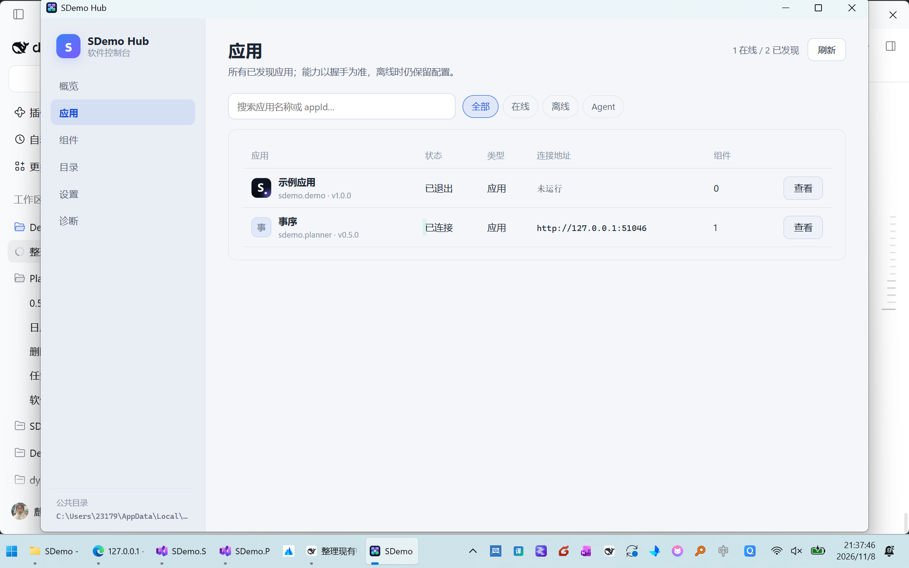
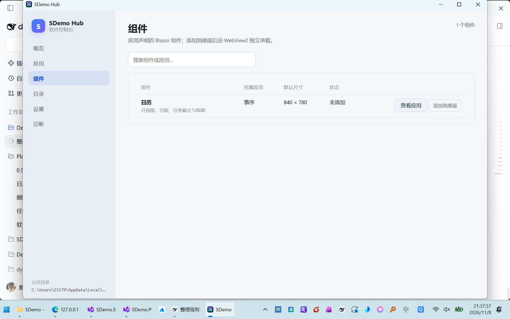
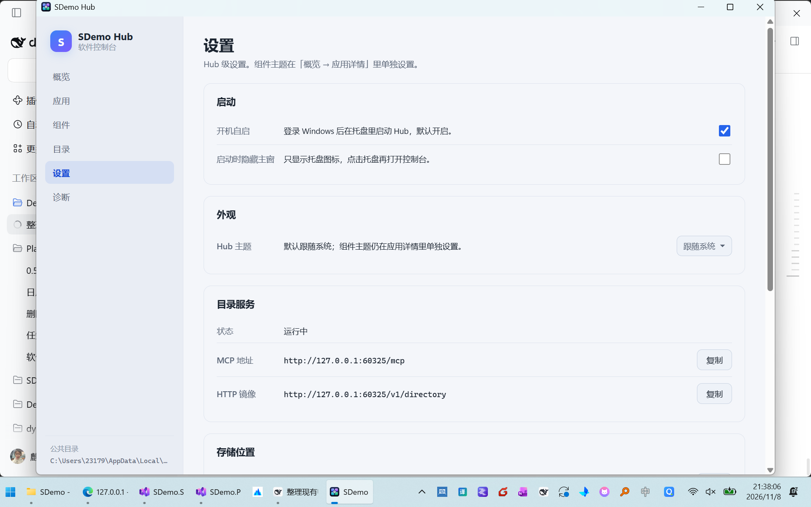
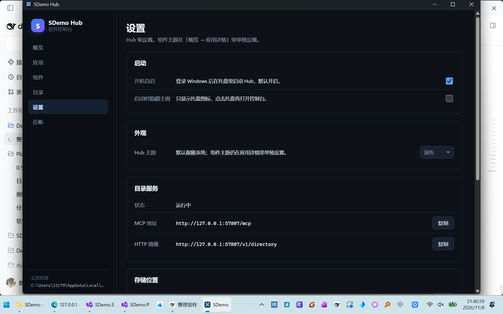

# 控制页：应用 / 组件 / 搜索 / Hub 主题

> 日期：2026-11-08
> 对应：FR-4.2 / FR-4.3 / FR-4.5 / FR-4.9
> 关联：[requirements-v2.md](requirements-v2.md) · [requirements-v2-audit.md](requirements-v2-audit.md)

---

## 1. 页面结构

侧栏现在有 6 个可用入口：

| 页面 | 内容 |
| --- | --- |
| 概览 | 应用卡片 + 详情（组件、主题、不透明度、热键、穿透）+ 搜索/筛选 + 目录地址 |
| 应用 | 表格：图标、名称/appId/版本、状态、类型、连接地址、组件数、查看 |
| 组件 | 汇总所有应用声明的组件：名称、所属应用、默认尺寸、是否在桌面、添加/移除 |
| 目录 | MCP / HTTP 镜像地址与当前目录内容 |
| 设置 | 启动、外观（Hub 主题）、目录服务、存储位置、关于 |
| 诊断 | 运行摘要、配置问题、日志/公共目录入口 |

### 应用页

- 离线应用保留在列表中，地址列显示 `未运行`，不会出现 `:0`。
- 「查看」跳到概览并展开该应用的详情。
- 搜索匹配名称、appId、连接地址；筛选取值为 `全部 / 在线 / 离线 / Agent`。

### 组件页

- 组件来自各应用的 `/v1/info`，不是本地扫描目录。
- 添加/移除直接写 `widgets.json`，与概览详情里的操作等价。

## 2. 应用图标

`HubAppConfig.icon` 是相对连接配置文件的路径，例如 `/sdemo.planner/icon.png`。
Hub 读取规则：

1. 以配置文件所在目录（`%LOCALAPPDATA%\SDemo\Hub\apps\`）为根；
2. 去掉开头的 `/`，拼接相对路径；
3. 文件存在且 ≤512 KB 时转成 `data:image/...;base64,...`，按文件修改时间缓存；
4. 任何失败都回退到首字母头像，不影响应用卡片。

> 约定：应用把图标放在公共目录下的 `<appId>/icon.png`，并在连接配置里写
> `"icon": "/<appId>/icon.png"`。这样离线时也能显示图标，且不需要向应用发 HTTP 请求。

## 3. Hub 主题

- 设置页「外观 → Hub 主题」：`跟随系统 / 浅色 / 深色`，存 `settings.json` 的 `theme`。
- 运行时写 `document.documentElement.dataset.theme`；`auto` 时删除该属性，交回
  `prefers-color-scheme`。
- CSS 中 `:root[data-theme="light"]` 覆盖浅色变量；深色是 `:root` 默认值。
- 原生标题栏通过 `DwmSetWindowAttribute(DWMWA_USE_IMMERSIVE_DARK_MODE)` 同步深浅色，
  避免深色内容配浅色标题栏。
- 组件主题仍在应用详情里独立设置，两者互不影响。
- 应用详情的每个组件行有不透明度滑杆（30%–100%）：整窗 `WS_EX_LAYERED + LWA_ALPHA`，标题栏与 WebView2 页面一起变淡，写 `widgets.json` 的 `opacity`；窗口标题栏的 `◐` 在 100% 与 65% 间切换。
- 组件行还显示当前窗口尺寸与层级（`544×728 · 桌面层 / 置顶`），并提供「置底」「置顶」两个显式动作；桌面窗口标题栏的改动会即时回写到概览。

## 4. 桌面组件窗口（2026-11-09）

所有组件窗口（不限应用、不限先后添加）共用同一套标题栏：

| 按钮 | 行为 |
| --- | --- |
| `◐` | 100% / 65% 不透明度切换 |
| `🖱` | 点击穿透 |
| `⤢` → `OK` | 进入尺寸调整模式；拖动窗口边缘改大小，点 `OK`（或 Enter）写回 `widgets.json`，Esc 取消 |
| `📍` / `📌` | 置顶 / 取消置顶（取消后回到底层） |
| `⬇` / `⬇✓` | 显式置底：取消置顶并压到所有普通窗口之下；`✓` 表示当前已在桌面层 |
| `✕` | 从桌面移除 |

- 默认 `ResizeMode=NoResize`，避免误拖边缘；只有 `⤢` 进入调整模式后才允许缩放。保存时同时写入宽高、位置与所在显示器。
- 新添加的组件在 `Show()` / `Loaded` 后会再压一次 `HWND_BOTTOM`，不会因为「后打开」而浮在旧组件或普通窗口之上。
- 标题栏、概览详情、托盘菜单共用 `WidgetHostService` 的同一个 placement；任一处改置顶/置底/穿透/不透明度/尺寸都会触发 `Changed`，概览立即刷新，不再需要重开主窗。
- 验证：67 个单元测试通过；实机确认任务组件与日历组件均为非 topmost 且位于所有普通窗口之下，调整尺寸后 `widgets.json` 与概览尺寸同步。

| 浅色 | 深色 |
| --- | --- |
|  |  |

## 5. 验证

- 应用页：在线 Planner + 离线示例应用同时显示；离线地址显示 `未运行`。
- 图标：示例应用使用 `/sdemo.demo/icon.png`，列表与详情均显示图标。
- 搜索：输入不存在的关键词显示「没有匹配的应用」；清空后恢复。
- 筛选：`离线` 只显示示例应用，`在线` 只显示 Planner。
- 组件页：添加日历后行状态变「在桌面」，`widgets.json` 写入 placement；移除后恢复。
- 主题：切到深色后 `document.documentElement.dataset.theme === "dark"`，背景变深；切回
  `auto` 后 dataset 删除，背景回到系统浅色。
- 构建：`dotnet build SDemo.Hub.slnf -c Release` 0 warning / 0 error。
- 测试：`dotnet test tests/SDemo.Hub.Tests -c Release` 67 passed。
